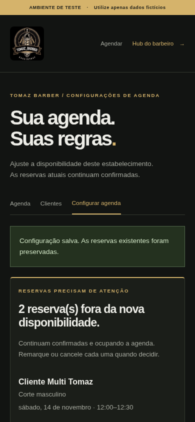
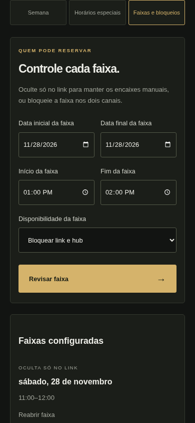
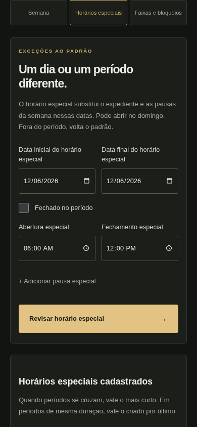

# Configurações de agenda no celular

Capturas reais do Chromium em viewport de 390 × 844 pixels, com agendamentos fictícios. Também foram verificadas as três áreas em 320 pixels, sem rolagem horizontal. O visual escuro e a logo da TOMAZ BARBER foram preservados.

Os exemplos mostram regras salvas durante os testes, incluindo uma reserva afetada que permanece confirmada. As capturas completas permitem conferir todos os campos; as capturas de tela mostram partes da página durante a navegação e rolagem normal.

| Visão da gestão                                               | Faixas e bloqueios                                      | Horário especial                                                     |
| ------------------------------------------------------------- | ------------------------------------------------------- | -------------------------------------------------------------------- |
|  |  |  |

Telas completas:

- [Expediente semanal e pausas](semana-completa.png)
- [Horários especiais, incluindo domingo aberto](especiais-completa.png)
- [Faixa oculta só no link e bloqueio nos dois canais](faixas-completa.png)

O fluxo de revisão exibe os atendimentos afetados antes de salvar. Depois da confirmação, eles continuam numa seção de atenção com ações individuais para remarcar ou cancelar. Não houve publicação ou envio de WhatsApp.
