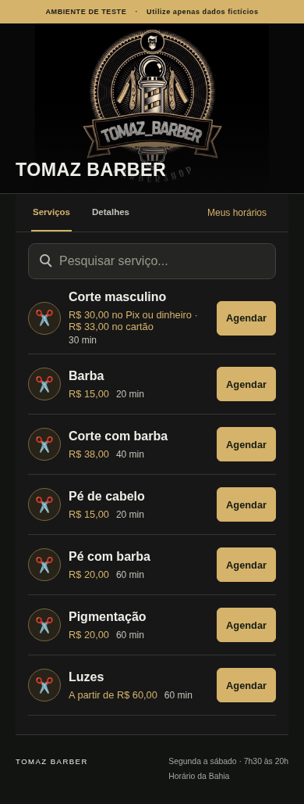
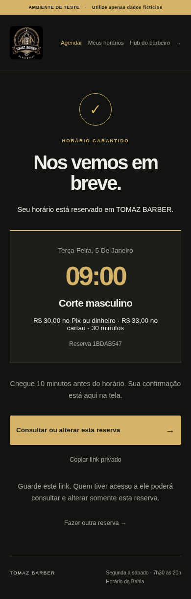
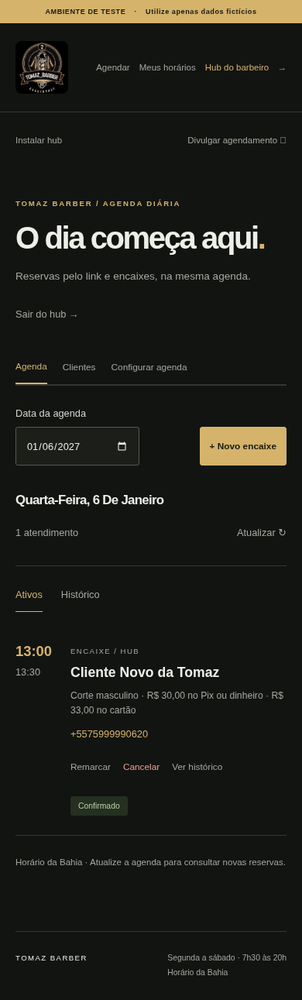
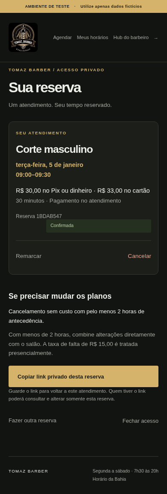
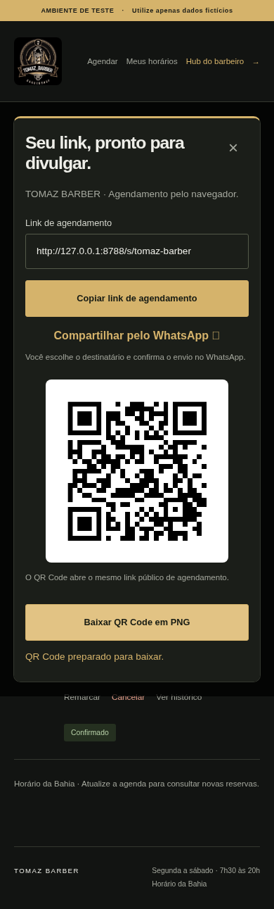
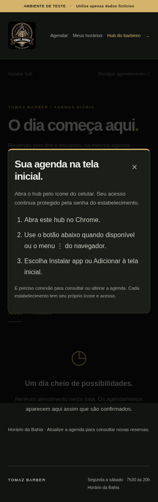

# Cliente e hub no celular

Capturas da aplicação em Chromium com largura de 390 pixels. Os testes também conferem 320 pixels. Todos os nomes, telefones e atendimentos são fictícios; Meta desativada. A aplicação não foi publicada.

## Telas principais

| Catálogo preservado | Confirmação com link privado | Agenda do barbeiro |
| --- | --- | --- |
|  |  |  |

| Acesso a uma reserva | Divulgação manual | Instalação |
| --- | --- | --- |
|  |  |  |

## Fluxos completos

- Cliente: [horários](horarios-mobile.png), [nome e celular](dados-mobile.png), [remarcação](remarcacao-mobile.png), [cancelamento](cancelamento-mobile.png).
- TOMAZ: [cadastro de clientes](clientes-tomaz-barber-mobile.png), [agenda](agenda-tomaz-barber-mobile.png), [link e QR](compartilhar-tomaz-barber-mobile.png).
- Aurora: [clientes próprios](clientes-salao-aurora-mobile.png), [agenda própria](agenda-salao-aurora-mobile.png), [link e QR próprios](compartilhar-salao-aurora-mobile.png).
- Hub: [instruções de instalação](instalar-mobile.png), [reconexão sem dados privados](hub-offline-mobile.png).
- Disponibilidade: as configurações existentes permanecem; veja as [telas de expediente, horários especiais e faixas](../previas-agenda/README.md), cobertas novamente pela suíte completa.

Os [QR Codes da TOMAZ](tomaz-barber-qr.png) e do [Aurora](salao-aurora-qr.png) foram baixados e decodificados pelo teste. Estes exemplos apontam para o endereço local do teste, não para um serviço publicado. No hub, o QR é gerado com o domínio da página aberta.

A instalação foi validada pelo manifesto e service worker no navegador. A instalação na tela inicial de Android/iPhone físico fica para o piloto. Veja os [detalhes e limites do acesso privado](../cliente-hub.md).
