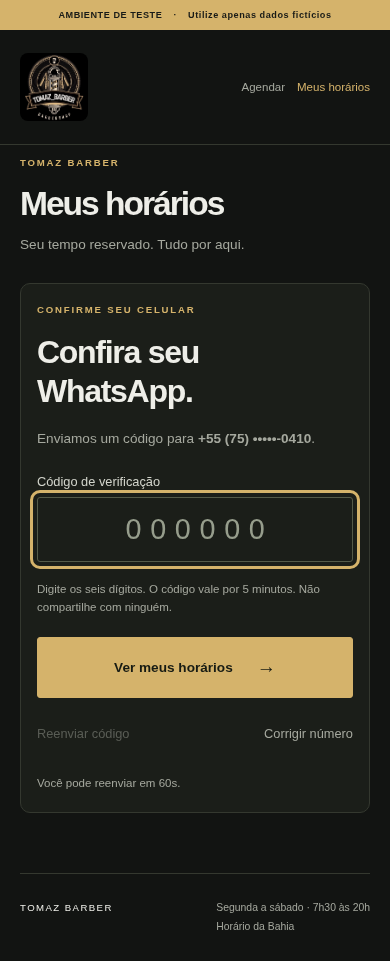
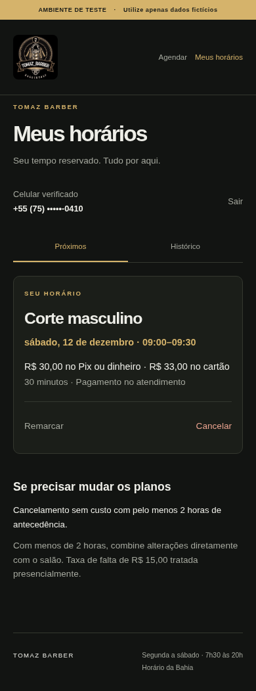

# Meus horários no celular

Capturas reais do Chromium em tela de 390 × 844 pixels, com rolagem completa da página. Os fluxos também foram verificados em 320 pixels, sem rolagem horizontal. Todos os números, clientes e reservas são fictícios. O código é recebido por um remetente simulado e digitado pelo teste; não há envio real de WhatsApp ou publicação.

O cliente continua agendando apenas com nome e celular. Para acessar suas reservas, informa o celular e confirma um código de seis dígitos. O código em si não aparece nas capturas.

| Código pelo WhatsApp                                   | Meus horários                                               |
| ------------------------------------------------------ | ----------------------------------------------------------- |
|  |  |

O fluxo completo:

- [Catálogo escuro com atalho Meus horários](catalogo-mobile.png)
- [Informe o celular para receber o código](acesso-mobile.png)
- [Digite o código recebido pelo WhatsApp](codigo-mobile.png)
- [Próximas reservas do cliente neste estabelecimento](meus-horarios-mobile.png)
- [Escolha e confirme o novo horário antes de liberar o atual](remarcacao-mobile.png)
- [Revise o cancelamento sem custo até duas horas antes](cancelamento-mobile.png)
- [Reserva cancelada preservada no histórico](historico-mobile.png)
- [Com menos de duas horas, a reserva é preservada até combinar com o salão](prazo-pendente-mobile.png)

As garantias de acesso, concorrência e o limite provisório para alterações próximas ao atendimento estão descritos em [Meus horários](../meus-horarios.md).
