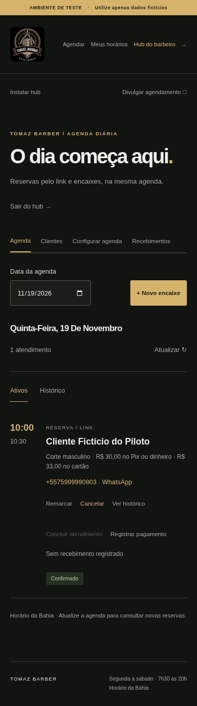
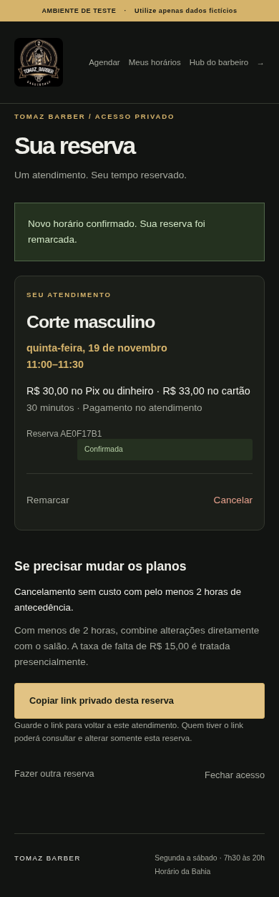
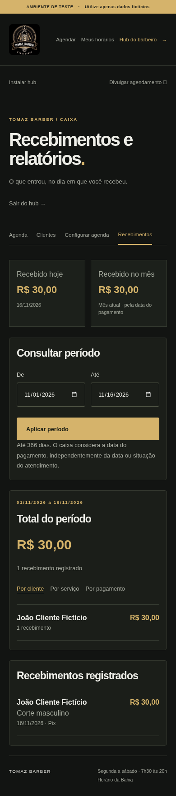

# Piloto — prévia local no navegador

Capturas do teste local com duas sessões independentes em largura de 390 pixels, dados fictícios e WhatsApp automático desligado. Não são capturas de uma publicação remota nem de aparelhos físicos.

| Reserva visível no hub | Alteração pelo link privado | Caixa do atendimento fictício |
| --- | --- | --- |
|  |  |  |

[Segunda reserva cancelada, preservada no histórico](piloto-cancelamento.png).

A nova reserva permanece futura e não pode ser concluída antes do início. Para conferir o caixa sem antecipar o relógio da aplicação, o teste conclui e recebe um atendimento histórico fictício. A sequência com o mesmo atendimento será conferida no piloto remoto, após chegar seu horário.

O QR Code local foi baixado, decodificado e aberto na segunda sessão. Ele não é disponibilizado como QR de teste nos celulares: aponta para loopback. O QR com endereço HTTPS será gerado somente depois da publicação na conta Cloudflare autorizada.

Veja [acesso necessário, roteiro e pendências](../piloto-cloudflare.md).
