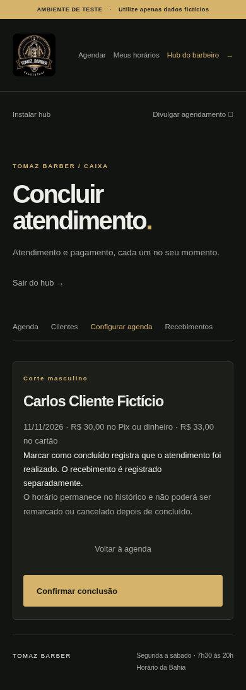
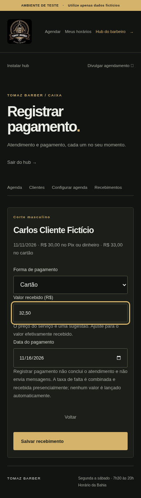
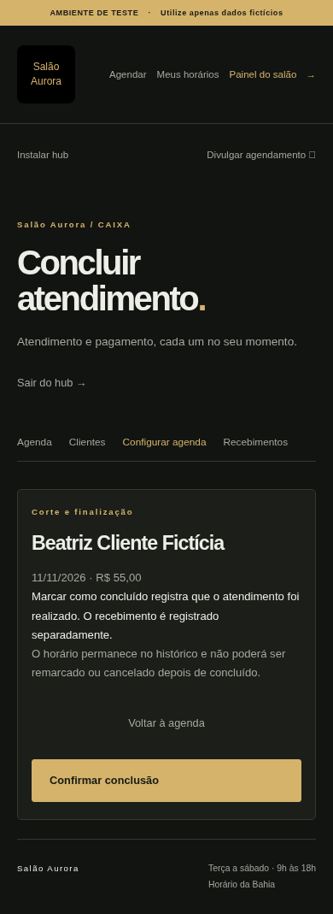
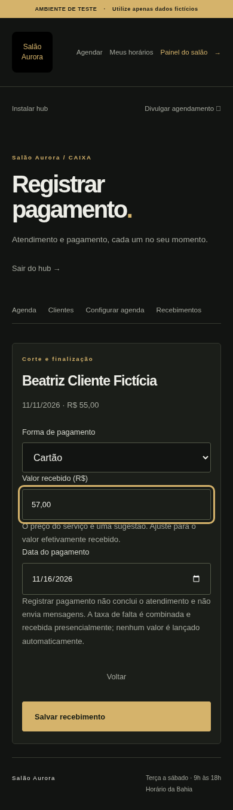
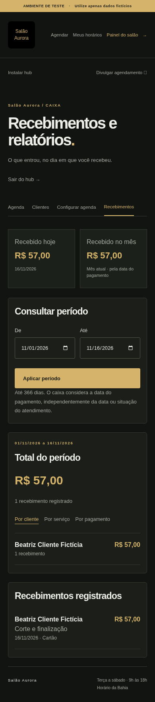

# Recebimentos no celular

Capturas reais da aplicação em Chromium com largura de 390 pixels; os testes também conferem 320 pixels. Nomes, telefones, atendimentos e valores são fictícios. WhatsApp automático desativado; aplicação sem publicação.

| Concluir atendimento | Registrar pagamento | Resumo do mês |
| --- | --- | --- |
|  |  |  |

A [agenda após concluir](concluido-tomaz-barber-mobile.png) mostra **Concluído** e **Sem recebimento registrado**, comprovando que as ações são separadas. O valor sugerido pode ser ajustado antes de salvar. O resumo considera a data do pagamento.

O Aurora mantém seus próprios dados:

| Concluir no Aurora | Pagamento no Aurora | Resumo do Aurora |
| --- | --- | --- |
|  |  |  |

[Agenda concluída do Aurora](concluido-salao-aurora-mobile.png) · [Regras, proteção contra duplicidade e validação](../recebimentos.md).
