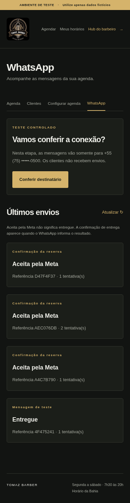
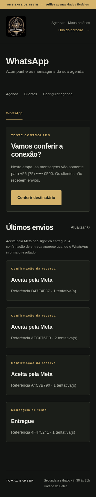

# WhatsApp no hub — revisão no celular

Capturas reais do Chromium durante os testes em 390 e 320 pixels. Tudo nesta captura é fictício: telefone, reservas, remetente Meta e recibos de entrega. Nenhuma mensagem real foi enviada para produzir as imagens.

O teste percorre o envio inicial `hello_world`, as confirmações de reserva pelo link e pelo hub, uma rejeição de modelo com nova tentativa segura e o webhook de entrega. O hub diferencia Aceita pela Meta de Entregue.

| Celular de 390 pixels                                     | Celular de 320 pixels                                  |
| --------------------------------------------------------- | ------------------------------------------------------ |
|  |  |

O destinatário exibido é fictício e os envios gerais para clientes estão desativados. O destinatário real autorizado foi informado depois destas capturas e está registrado somente em configuração privada. O primeiro envio real depende de configurar o acesso ao remetente de teste da Meta e seus secrets.

[Guia da integração e do teste real](../whatsapp.md) · [Modelos para aprovação na Meta](../whatsapp-modelos/README.md).
