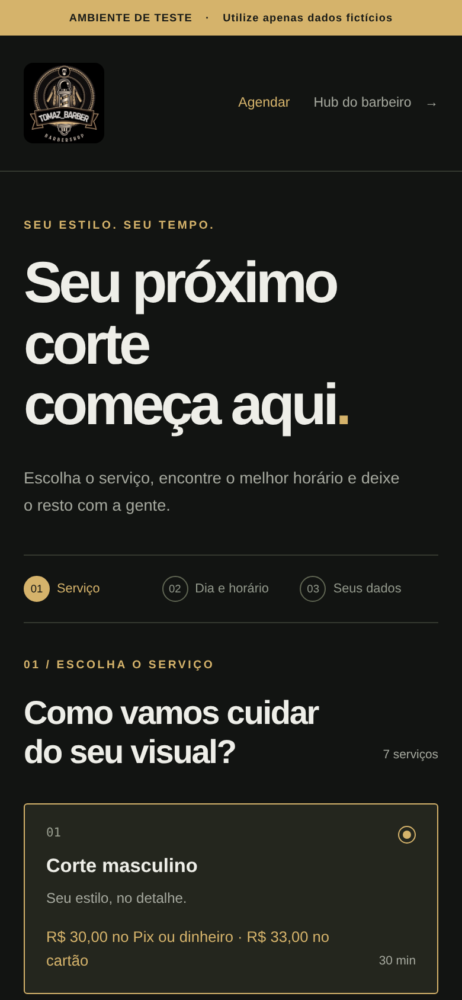
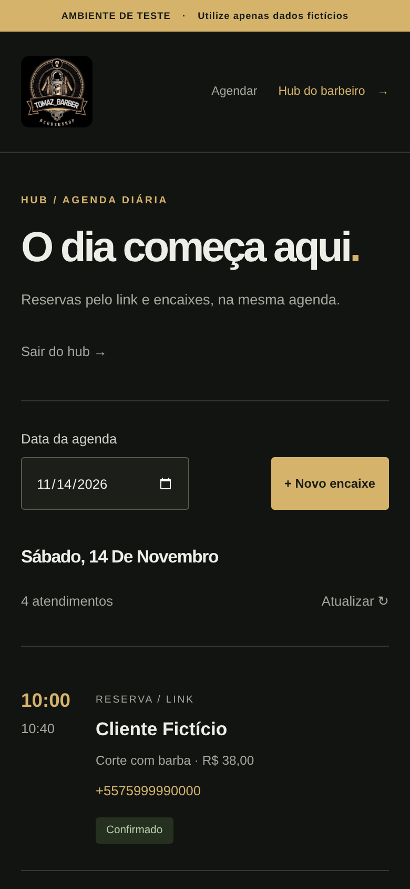

# Logo no agendamento e no hub

Capturas reais do commit `0152b016680c33cd5041f1122d4c71df6ce9efd1` do PR #1, realizadas em 13/11/2026. Viewport de celular de 390 × 844 pixels, densidade 2, Chromium com toque e emulação mobile. O hub está autenticado e utiliza apenas dados fictícios.

A logo original carrega em ambas as páginas e ocupa 68 × 68 pixels CSS no cabeçalho. Não houve rolagem horizontal nem erros de JavaScript. Os três testes de navegador passaram. Estas imagens estão aguardando aprovação visual do proprietário; não houve publicação.

| Agendamento | Hub |
| --- | --- |
|  |  |
